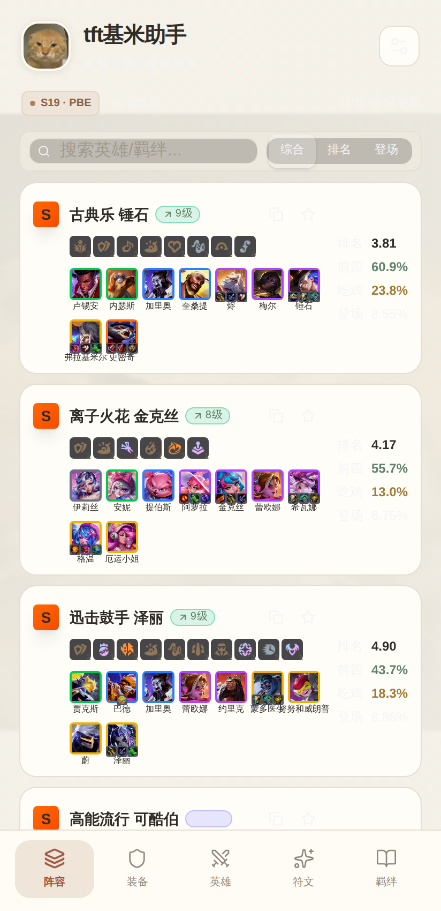
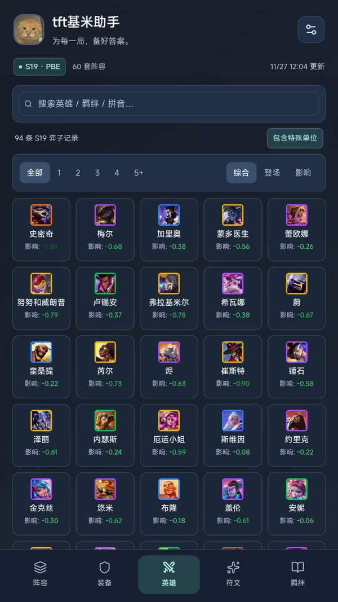
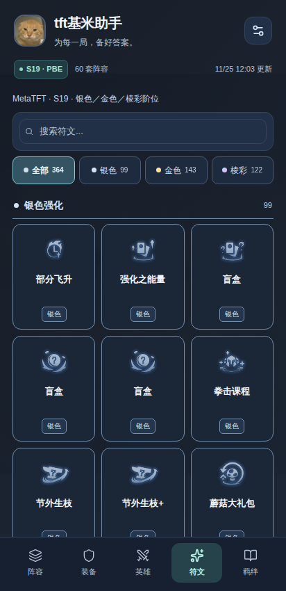

<div align="center">

# tft基米助手 · TFT Kimi

**Teamfight Tactics comps, augments and items — on your phone, offline-first.**

[](https://github.com/9agj/tft-kimi-assistant/releases)
[](LICENSE)
[](#download)
[](#build-from-source)
[](https://github.com/9agj/tft-kimi-assistant/issues)

[English](README.md) · [简体中文](README.zh-CN.md)

&nbsp;&nbsp;
&nbsp;&nbsp;


</div>

---

A native Android shell around a React interface: browse the current set's comps, units, items and augments, or float a compact overlay on top of the game while you play. Data refreshes every 4 hours on our own server and syncs into the app — **no reinstall needed for a data update**.

> Unofficial fan project. Not affiliated with Riot Games, Tencent, or MetaTFT. Game data and artwork belong to their respective owners — see [NOTICE](NOTICE).

## Features

| | |
|---|---|
| **Comp tier list** | 60 comps rated S/A/B/C/D, same algorithm in the main list and the overlay |
| **Comp detail** | Positioning, item builds, transitions, variants, unit & trait stats |
| **Units** | Purchasable and special units with cost, ability and recommended items |
| **Items** | Including radiant-item frames |
| **Augments** | Silver / Gold / Prismatic rarity, plus an S/A strength reference list |
| **In-game overlay** | Android foreground service showing comps and trait counters above the game |
| **Offline first** | A snapshot ships inside the APK; the app syncs the newest one when online |

## Download

Grab the latest APK from **[Releases](https://github.com/9agj/tft-kimi-assistant/releases)**. Release notes live in [CHANGELOG.md](CHANGELOG.md) — every version and its changelog are published here on GitHub.

- Package: `com.kimi.tft`
- Current: **v1.2.5** (versionCode 8), minSdk 26 / targetSdk 34
- The APK is signed with the same key across releases, so upgrades install over the old version

## Architecture

```
data source ──► scrape.mjs (every 4 h) ──► data/snapshots/<id>/ ──► data/current (symlink)
                                                                          │
                                                            http.mjs :8798 (loopback only)
                                                                          │
                                                              Nginx  /tft-kimi/  reverse proxy
                                                                          │
      Android app ──► DataSync (manifest + data.zip, per-file SHA-256) ──► local snapshot
                   └─► LocalServer :ephemeral ──► WebView (main UI / overlay)
```

Three independent pieces:

| Part | Location | Stack |
|---|---|---|
| Android shell | `android/` | Java, no Gradle — `aapt2` + `javac` + `d8` + `apksigner` |
| UI | `frontend/apps/react/` | React + TypeScript + Vite, built into `android/assets/www` |
| Cloud data service | `server/` | Node.js native `http`, read-only, binds `127.0.0.1` only |

## Build from source

### Android APK

Requires JDK 17+ and an Android SDK (build-tools 34/35, platform android-34).

```bash
node tools/prepare_assets.mjs   # assemble assets from the current snapshot + frontend dist
bash android/build.sh           # compile, dex, sign → out/tft基米助手-v<version>.apk
```

The signing password never lives in the source tree — supply it through the environment or a `signing/signing.env` file:

```bash
export KIMI_STORE_PASS='...'                          # or put it in signing/signing.env
export KIMI_CLOUD_URL='https://<your-host>/tft-kimi/' # optional: bake in another cloud endpoint
```

The keystore is **PKCS#12** (`-storetype PKCS12`), so the key password follows the store password and cannot be changed separately.

### Frontend

```bash
cd frontend
pnpm install --ignore-scripts --no-frozen-lockfile
pnpm run build:packages
pnpm run build:react            # output: frontend/apps/react/dist
```

### Tools

`tools/` keeps its own lockfile:

```bash
npm --prefix tools ci
```

## Deploy the data service

```bash
install -d /opt/tft-kimi
# sync server/, frontend/apps/react/dist/, data/ … into that directory
cp server/tft-kimi-data.service server/tft-kimi-scrape.{service,timer} /etc/systemd/system/
systemctl daemon-reload
systemctl enable --now tft-kimi-data.service tft-kimi-scrape.timer
```

The service listens on `127.0.0.1:8798` only; Nginx fronts it (note the trailing slash on `proxy_pass` — it strips the `/tft-kimi/` prefix):

```nginx
location ^~ /tft-kimi/ {
    proxy_pass http://127.0.0.1:8798/;
}
```

| Variable | Default | Purpose |
|---|---|---|
| `KIMI_ROOT` | `/opt/tft-kimi` | Data and service root |
| `PORT` | `8798` | Listen port, loopback only |
| `KIMI_ALERT_CONF` | `config/alert.json` | Health-check alert config |

## How the data works

- A scrape runs every 4 hours; a failed run keeps the last published snapshot
- Each snapshot gets a per-file SHA-256 manifest, then `data/current` is switched atomically
- The client verifies archive and per-file hashes, core files and the set marker before switching; versions may only move forward
- **The augment S/A list is currently a Set 18 reference list**: the upstream `augments_tiers` endpoint returns `TFTSet19` at the outer level while `tier_list_set` is still `TFTSet18`, so the UI labels it "reference" and never mixes it with Set 19 data
- Rarity (silver/gold/prismatic), comp rating (S/A/B/C/D) and augment strength (S/A/B/C/D) are three unrelated scales

When the source data is missing a field, the UI shows an explicit placeholder instead of inventing a value.

## Project layout

```
android/     native project: manifest, res, src, assets (api / www / cdn / art), build.sh
server/      http.mjs (read-only static server), scrape.mjs, augment-ranking.mjs, systemd units
frontend/    monorepo: apps/react (this UI), apps/website, packages/*
tools/       prepare_assets.mjs, export_delivery.mjs, republish-snapshot.mjs, alert-check.mjs
tests/       acceptance.mjs, visual.mjs, augment-sorting.test.mjs
docs/        build notes, release notes, feature walkthrough, screenshots
```

`out/`, `backup/`, `archive/` and `releases/` are local build/archive directories and are not tracked.

## Known limitations

- Overlay survival in the background depends on each ROM's battery policy — needs device testing
- No background scheduled sync; the app checks when opened (throttled to 15 minutes)
- No in-app APK download: a new version is announced and opens the release page

## Feedback

Bugs, wrong data, or feature ideas — all welcome in [Issues](https://github.com/9agj/tft-kimi-assistant/issues):

- [Report a bug](https://github.com/9agj/tft-kimi-assistant/issues/new?template=bug_report.yml)
- [Request a feature](https://github.com/9agj/tft-kimi-assistant/issues/new?template=feature_request.yml)

The same entry points exist inside the app under **Settings → Feedback**.

## License

Code released under the [MIT License](LICENSE). Third-party data and artwork are attributed in [NOTICE](NOTICE).
