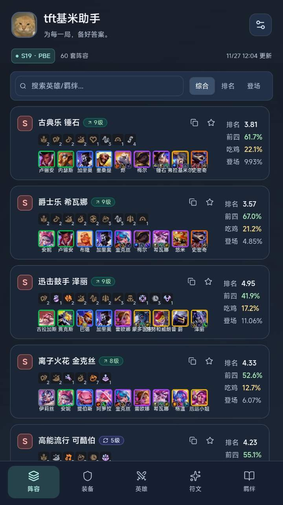
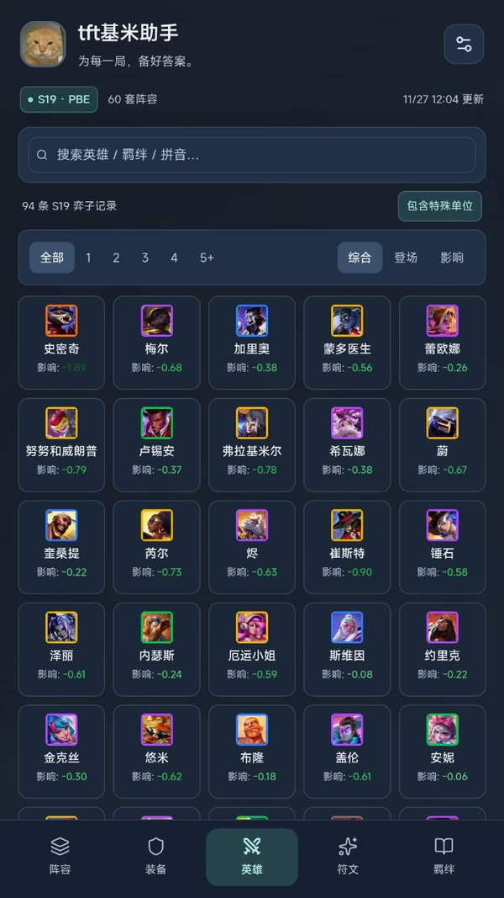
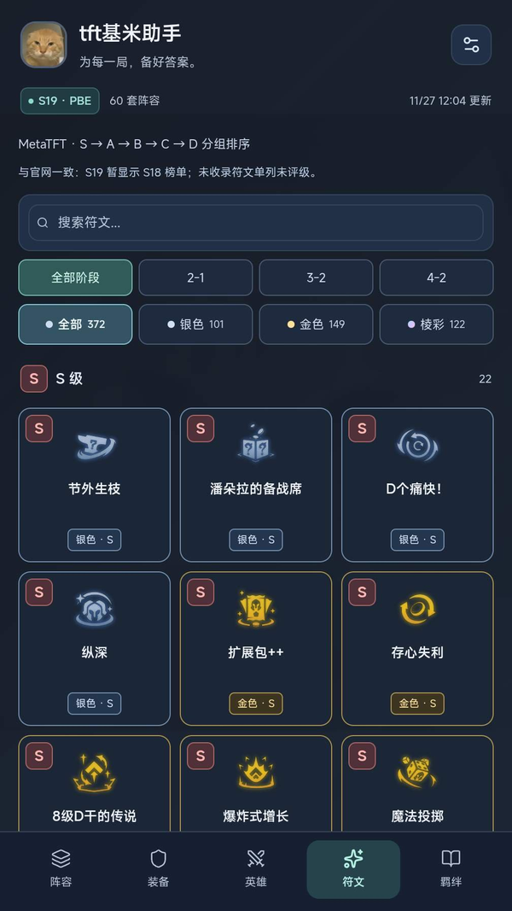
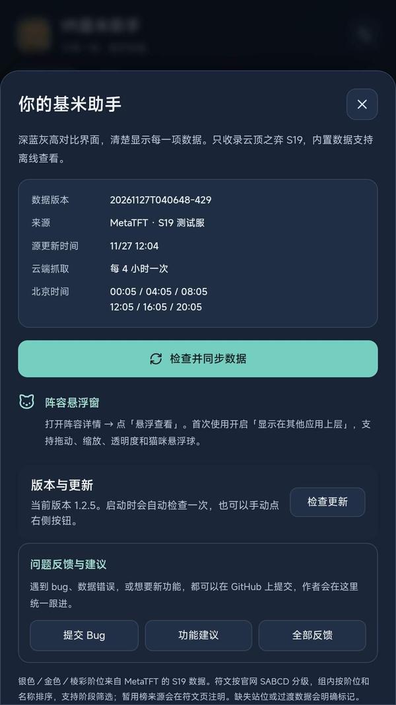

<div align="center">

# tft基米助手 · TFT Kimi

**云顶之弈阵容 / 强化 / 装备查询，离线优先。**

[](https://github.com/9agj/tft-kimi-assistant/releases)
[](LICENSE)
[](#下载)
[](#从源码构建)
[](https://github.com/9agj/tft-kimi-assistant/issues)

[English](README.md) · [简体中文](README.zh-CN.md)

&nbsp;&nbsp;
&nbsp;&nbsp;


</div>

---

Android 原生外壳 + React 界面：查当前赛季的阵容、弈子、装备与强化，也能在游戏上层浮一个小窗边打边看。数据由自建服务每 4 小时抓一轮并同步进 App——**换数据不用重新装包**。

> 非官方工具，与 Riot Games、腾讯、MetaTFT 均无隶属关系。游戏数据与图片版权归各自所有者，详见 [NOTICE](NOTICE)。

## 功能

| | |
|---|---|
| **阵容榜** | 60 套阵容，S/A/B/C/D 评级；主榜与悬浮窗共用同一套算法 |
| **阵容详情** | 站位、出装、过渡、变阵、弈子与羁绊统计 |
| **弈子** | 可购买单位与特殊单位，含费用、技能、推荐出装 |
| **装备** | 含光明装备专用边框 |
| **强化** | 银 / 金 / 棱彩稀有度分类，另附 S/A 强度参考榜 |
| **游戏内悬浮窗** | Android 前台服务，在游戏上层显示阵容与羁绊计数 |
| **离线可用** | 数据随 APK 内置一份，联网后自动同步云端最新快照 |

## 下载

安装包统一发布在 **[Releases](https://github.com/9agj/tft-kimi-assistant/releases)**，版本说明见 [CHANGELOG.md](CHANGELOG.md)——本项目所有版本更新与更新日志都在 GitHub 维护。

- 包名：`com.kimi.tft`
- 当前版本：**v1.2.5**（versionCode 8），minSdk 26 / targetSdk 34
- 各版本使用同一把签名密钥，可直接覆盖安装升级

## 架构

```
数据源 ──► scrape.mjs（每 4 小时）──► data/snapshots/<id>/ ──► data/current（符号链接）
                                                                     │
                                                       http.mjs :8798（仅回环）
                                                                     │
                                                         Nginx  /tft-kimi/  反代
                                                                     │
     Android App ──► DataSync（manifest + data.zip，逐文件 SHA-256）──► 本地快照
                  └─► LocalServer :随机端口 ──► WebView（主界面 / 悬浮窗）
```

三条独立的线：

| 部分 | 位置 | 技术栈 |
|---|---|---|
| Android 外壳 | `android/` | Java，无 Gradle——`aapt2` + `javac` + `d8` + `apksigner` 直编 |
| 界面 | `frontend/apps/react/` | React + TypeScript + Vite，产物塞进 `android/assets/www` |
| 云端数据服务 | `server/` | Node.js 原生 `http`，只读，仅监听 `127.0.0.1` |

## 从源码构建

### Android APK

需要 JDK 17+ 与 Android SDK（build-tools 34/35、platform android-34）。

```bash
node tools/prepare_assets.mjs   # 从当前快照与前端的 dist 组装资源
bash android/build.sh           # 编译、dex、签名 → out/tft基米助手-v<版本>.apk
```

签名口令不进源码树，通过环境变量或 `signing/signing.env` 提供：

```bash
export KIMI_STORE_PASS='...'                          # 或写进 signing/signing.env
export KIMI_CLOUD_URL='https://<你的域名>/tft-kimi/'   # 可选，覆盖内置云地址
```

签名库使用 **PKCS#12**（`-storetype PKCS12`），key 口令随 store 口令，不能单独改。

### 前端

```bash
cd frontend
pnpm install --ignore-scripts --no-frozen-lockfile
pnpm run build:packages
pnpm run build:react            # 产物在 frontend/apps/react/dist
```

### 工具依赖

`tools/` 有独立 lockfile：

```bash
npm --prefix tools ci
```

## 部署数据服务

```bash
install -d /opt/tft-kimi
# 把 server/、frontend/apps/react/dist/、data/ 等同步到该目录
cp server/tft-kimi-data.service server/tft-kimi-scrape.{service,timer} /etc/systemd/system/
systemctl daemon-reload
systemctl enable --now tft-kimi-data.service tft-kimi-scrape.timer
```

服务只监听 `127.0.0.1:8798`，对外由 Nginx 反代（注意 `proxy_pass` 尾斜杠会剥掉 `/tft-kimi/` 前缀）：

```nginx
location ^~ /tft-kimi/ {
    proxy_pass http://127.0.0.1:8798/;
}
```

| 变量 | 默认 | 说明 |
|---|---|---|
| `KIMI_ROOT` | `/opt/tft-kimi` | 数据与服务根目录 |
| `PORT` | `8798` | 监听端口，仅回环 |
| `KIMI_ALERT_CONF` | `config/alert.json` | 巡检告警配置 |

## 数据说明

- 每 4 小时抓取一轮，失败保留上一份已发布快照
- 新快照先生成逐文件 SHA-256 清单，再原子切换 `data/current` 符号链接
- 客户端下载后校验包与每份 JSON 的哈希、核心文件完整性、赛季标记，通过才切换；版本号只允许前进
- **强化 S/A 强度榜当前是 S18 参考榜**：数据源 `augments_tiers` 接口外层返回 `TFTSet19`，实际 `tier_list_set` 仍为 `TFTSet18`，界面据此标注「参考榜」，不与 S19 数据混用
- 稀有度（银/金/棱彩）、阵容评级（S/A/B/C/D）、强化强度榜（S/A/B/C/D）是三套互不相关的口径

源数据本身有缺项时不补造，界面显示为缺省提示。

## 目录结构

```
android/     原生工程：Manifest、res、src、assets（api / www / cdn / art）、build.sh
server/      http.mjs（只读静态服务）、scrape.mjs、augment-ranking.mjs、systemd unit
frontend/    monorepo：apps/react（本项目界面）、apps/website、packages/*
tools/       prepare_assets.mjs、export_delivery.mjs、republish-snapshot.mjs、alert-check.mjs
tests/       acceptance.mjs、visual.mjs、augment-sorting.test.mjs
docs/        构建说明、版本说明、功能解析、截图
```

`out/`、`backup/`、`archive/`、`releases/` 为本地构建与归档目录，不入库。

## 已知限制

- 悬浮窗的长期后台存活受各家 ROM 省电策略影响，需实测
- 未做后台定时同步（只在打开应用时检查，节流 15 分钟）
- 无应用内下载安装包：发现新版本只提示并打开下载页

## 反馈

遇到 bug、数据错误，或想提新功能，都可以在 [Issues](https://github.com/9agj/tft-kimi-assistant/issues) 提交：

- [提交 Bug](https://github.com/9agj/tft-kimi-assistant/issues/new?template=bug_report.yml)
- [功能建议](https://github.com/9agj/tft-kimi-assistant/issues/new?template=feature_request.yml)

App 内同样有三个入口，在 **设置 → 问题反馈与建议**；旁边的 **版本与更新** 会查 GitHub Releases，有新版时给出下载页：



App 内「设置 → 问题反馈与建议」有同样的入口。

## 许可证

本项目代码以 [MIT](LICENSE) 协议发布；第三方数据与素材的归属见 [NOTICE](NOTICE)。
